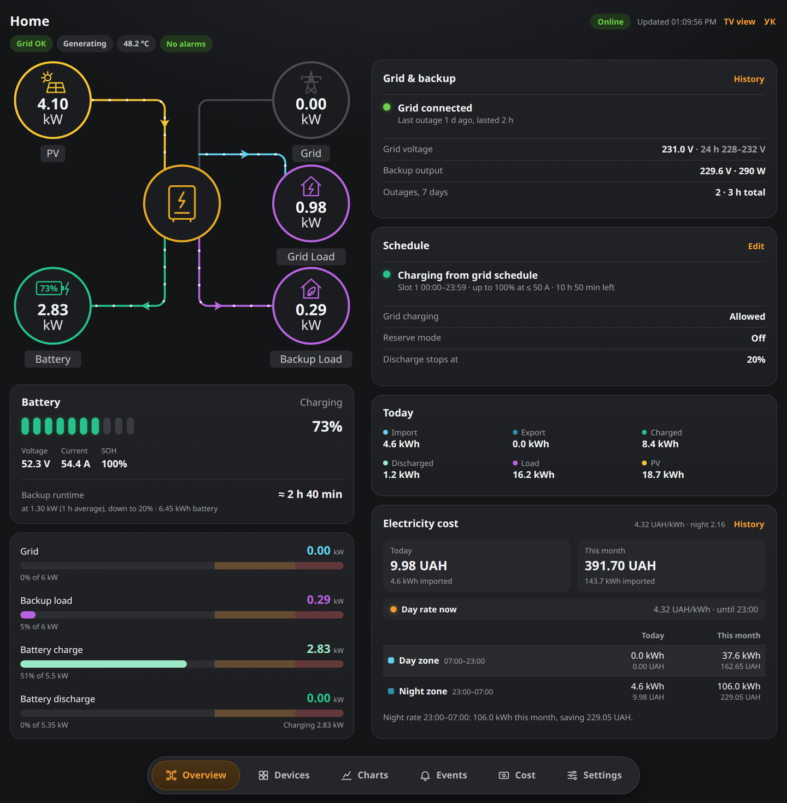
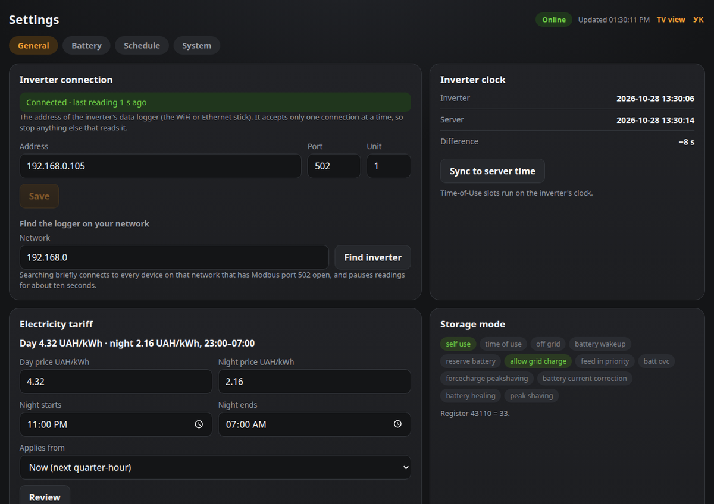
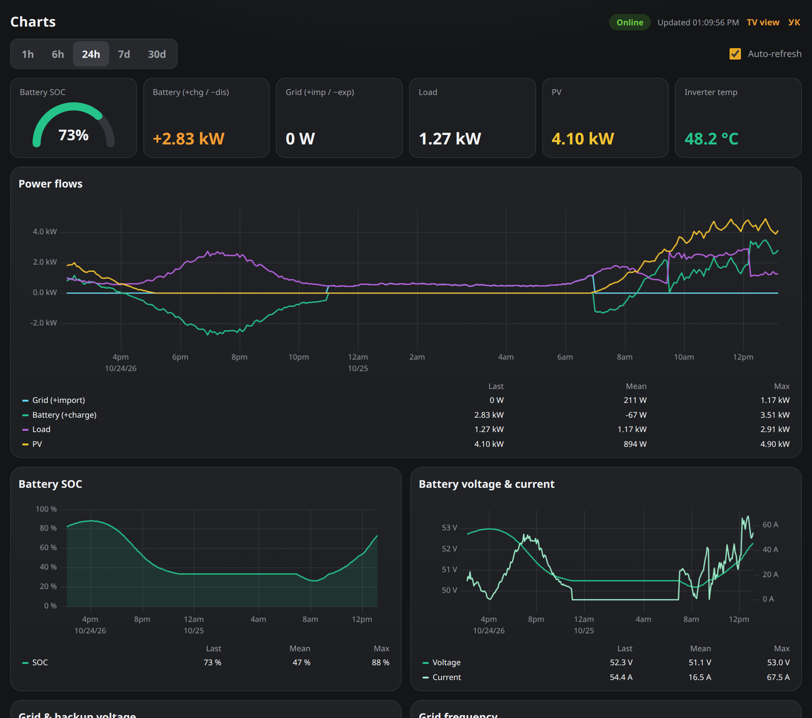
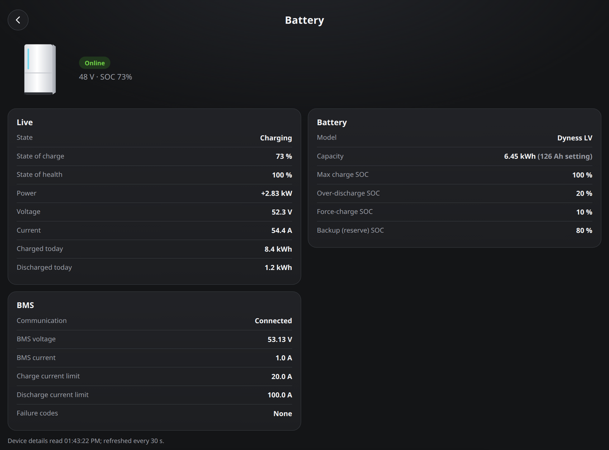
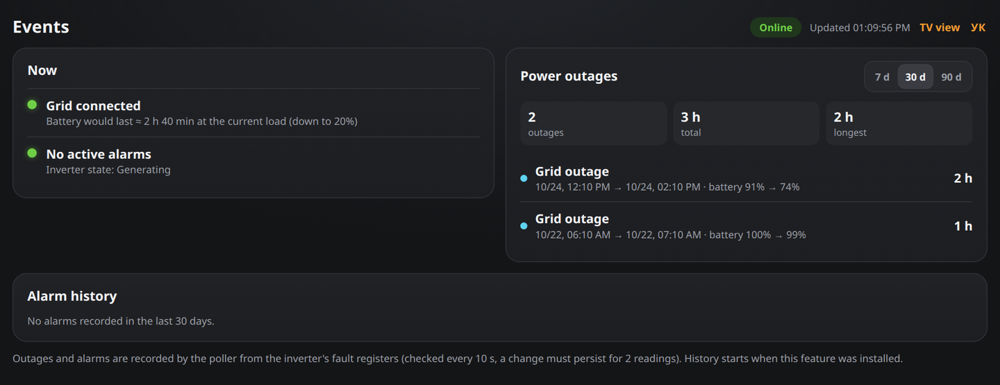
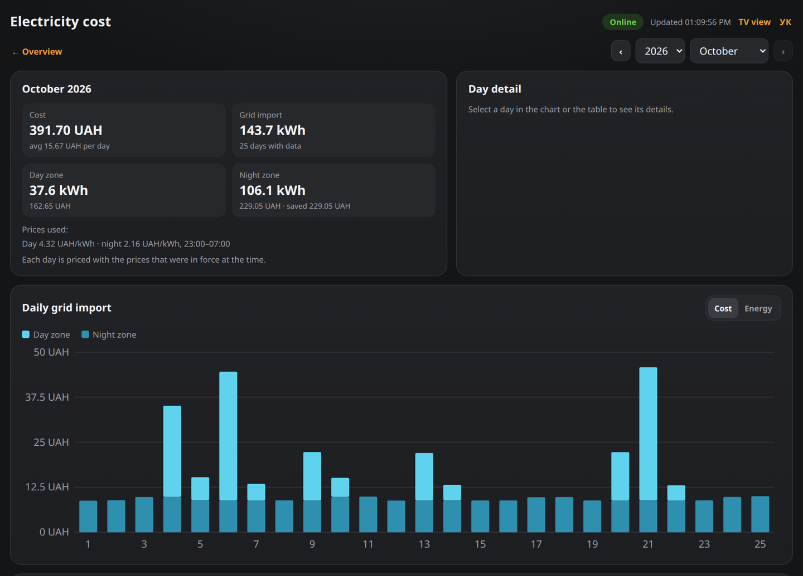
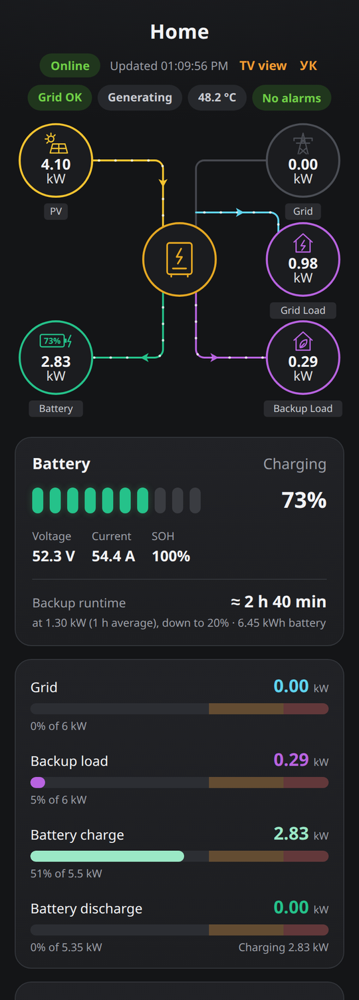
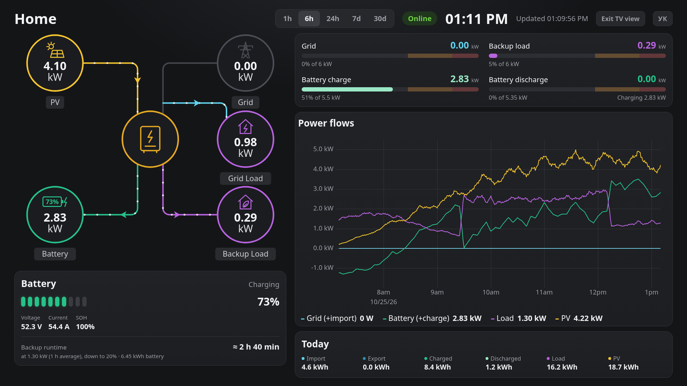
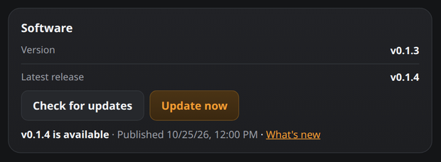

# Solis Monitor

[](https://github.com/vtlvolkov/solis-monitor/actions/workflows/test.yml)
[](LICENSE)

**A free, self-hosted dashboard for Solis hybrid inverters.** Live power flow, charts, outage history, electricity cost and Telegram alerts, running on a Raspberry Pi or any small Linux machine in your home. One command installs it.



## What you get

- **Live power flow** between solar, grid, battery and your house, updated every 10 seconds, with gauges that turn amber and red as you approach the inverter's limits.
- **Backup runtime estimate**: how long the battery would last if the grid went out right now.
- **Charts** for any period from one hour to 30 days: power, battery charge, voltage, frequency, daily energy.
- **Outage and alarm history**: when the grid dropped, for how long, and how far the battery fell.
- **Electricity cost** with day and night rates, per day and per month. Changing a price never rewrites past days.
- **Telegram alerts** for outages, low battery during an outage, alarms and a lost inverter connection.
- **Works on phones and TVs**: a responsive layout, a wall-display mode and an Android TV app. English and Ukrainian.
- **Read-only unless you say otherwise.** Changing battery settings from the dashboard is off by default.
- **Your data stays with you** in a local InfluxDB database. Nothing is sent to any cloud.

## What you need

- A **Solis hybrid inverter** with its WiFi or Ethernet data logger on your home network. Tested with the **S6-EH1P**; other Solis hybrids that speak the same Modbus protocol will probably show most values, but only the S6-EH1P has been checked against hardware.
- A **64-bit Linux machine** on the same network that stays on: a Raspberry Pi 4 or 5 (64-bit Raspberry Pi OS or Ubuntu Server) or any Debian/Ubuntu PC or mini-server, with 2 GB of RAM or more and an internet connection while installing.

## Install

On that machine, run:

```bash
curl -fsSL https://github.com/vtlvolkov/solis-monitor/releases/latest/download/install.sh | sudo bash
```

The installer asks for a dashboard login, finds your inverter, installs Docker if it is missing, downloads the ready-made images and starts everything:

```text
== Dashboard login
Admin user name [admin]:
Admin password:
Name of this installation (shown as the dashboard title; Enter to skip): Home

== Inverter
Look for the inverter on 192.168.1.0/24 now? [Y/n]
Scanning 192.168.1.1-254 for Modbus TCP on port 502 (takes a few seconds) ...
Found a Modbus device at 192.168.1.50
Is that your inverter's data logger? [Y/n]

Install now? [Y/n]
...
Done.
  Dashboard: http://192.168.1.20:8088
```

It takes a few minutes. Open the address it prints in any browser on your network.

<details>
<summary>Prefer to read the script first, or install without questions?</summary>

Download it, read it, then run it:

```bash
curl -fsSLO https://github.com/vtlvolkov/solis-monitor/releases/latest/download/install.sh
less install.sh
sudo bash install.sh
```

Every question has a flag, so it can run unattended. `--dry-run` shows the plan and changes nothing, and `--help` lists everything:

```bash
sudo bash install.sh --yes --user admin --password 'choose-a-password' --inverter 192.168.1.50 --site-name Home
```

</details>

## First steps

1. **Open the dashboard** at `http://<machine-ip>:8088`. Within half a minute the pill in the top right turns green and says **Online**.
2. **Check the inverter connection** (only if the pill stays Offline): Settings → General → **Inverter connection** shows the logger's address and whether it is reachable, and **Find inverter** searches your network for it.

   
3. **Look around.** Nothing is asked for until you open the **Settings** page, where the browser prompts for the admin name and password you chose.
4. **Add your electricity prices** (optional): Settings → *Electricity tariff*. The cost card on the Overview appears once a day price is set.
5. **Turn on Telegram alerts** (optional): see [Alerts and AI agents](docs/alerts-and-agents.md).

## A tour

### Charts



Pick 1 h to 30 d. Every chart shows the last, mean and maximum value, and the daily energy bars at the bottom go back 30 days.

### Devices



Inverter, battery (with BMS limits and fault codes), data logger and grid meter, read live from the inverter.

### Events



Every grid outage with its start, duration and battery level before and after, plus alarms with decoded fault names. A red banner and a runtime estimate appear on the Overview during an outage.

### Electricity cost



Open it from the cost card on the Overview. Every day is priced with the rates that applied at that time, split into day and night zones.

### On your phone



The same pages, rearranged for a narrow screen.

### On a TV



`http://<machine-ip>:8088/?view=tv` (or the **TV view** link in the header) fills a wall display with the diagram, gauges and a chart. There is also a small [Android TV app](docs/tv-app.md) that opens it full screen: download [`solis-tv.apk`](https://github.com/vtlvolkov/solis-monitor/releases/latest/download/solis-tv.apk) from the latest release.

## Optional features

| | |
|---|---|
| **Telegram alerts** and **AI agent access** (read-only MCP) | [Alerts and AI agents](docs/alerts-and-agents.md) |
| **Changing battery settings** from the dashboard: work mode, charge limits, time-of-use schedule. Off by default | [Changing inverter settings](docs/settings.md) |
| **Android TV app** and wall display | [TV display](docs/tv-app.md) |
| What every page and number means, environment variables, API | [Dashboard guide](docs/dashboard.md) |
| **Umbrel**: add this repository as a community app store and install Solis Monitor from the App Store | [Solis Monitor on Umbrel](docs/umbrel.md) |
| Building from source, a second site | [Advanced](docs/advanced.md) |

## Updating

The installer puts a small command on your machine:

```bash
solis-monitor status            # version, containers, latest poller log lines
solis-monitor update            # install the newest tagged release (rolls back if it fails to start)
solis-monitor auto-update on    # optional: look for a new release every night (off by default)
solis-monitor logs poller       # recent log lines of a service (poller, web or influxdb); add -f to follow
solis-monitor edit              # open your settings file (.env) in an editor, then apply the changes
solis-monitor apply             # apply a .env you edited by hand (restarts only what changed)
```

**From the dashboard:** when a newer release exists, an **Update available** badge appears next to the Online pill on every page (the server looks for one every 6 hours). Click it to open **Settings → System → Software** with the update ready to confirm, or press **Check for updates** there yourself.


Then **Update now**. A progress bar shows the current step (looking for the release, downloading the images, restarting, waiting for the new version). The dashboard restarts for a few minutes and reconnects by itself; if the new version fails to start, the old one is restored automatically. This works on installs made by the installer (turn it off with `--no-dashboard-updates` or `solis-monitor dashboard-updates off`), needs your Settings login, and the update itself never starts without your confirmation. **Privacy:** the background check sends one normal HTTPS request to `api.github.com` every ~6 hours (your IP address and the name `solis-monitor`, nothing else). Turn it off with `--no-update-check` when installing, or `UPDATE_CHECK_HOURS=0` in `.env` (then only the button checks).



Updates only ever install tagged releases, never unreleased code, and your settings (`/opt/solis-monitor/.env`) and history are left alone. `solis-monitor apply` stops you from changing the database passwords and token (`INFLUX_*`), which only count on the very first start and would lock the dashboard out of its own database.

## Troubleshooting

**The pill says Offline, or there are no numbers.** The poller cannot reach the inverter's data logger. Check `solis-monitor logs poller`:
- `cannot connect` or `No route to host`: the address is wrong, or the logger is off the network. Open **Settings → General → Inverter connection**, fix the address (or press **Find inverter**) and **Save**: no restart is needed.
- It connects but keeps timing out: **the logger accepts one connection at a time.** Stop anything else that reads it (Home Assistant, another monitor, a second copy of this stack), wait a minute and look again.

**`No route to host` / `Destination Host Unreachable`, though your router lists the logger as connected.** The WiFi stick can hang while staying associated, so the router still shows it but it no longer answers anyone (`ip neigh show <logger ip>` says `INCOMPLETE`, and no device on the network can ping it). Unplug the stick from the inverter for about 10 seconds, plug it back in and wait a minute or two; the poller reconnects by itself and the missing time shows as a gap in the charts. If it keeps happening, improve the WiFi signal at the stick (a closer router or a repeater).

**"GitHub's limit for your network is used up" when checking for updates.** GitHub lets each public IP address make 60 anonymous requests an hour, shared by every device at your home that talks to it. The message says when the limit lifts; the dashboard does not ask again until then, and `solis-monitor update --version vX.Y.Z` works the same way. The automatic check is one request every ~6 hours, so this only happens after a lot of manual checking.

**The installer found nothing.** It still installs, and the dashboard waits for an address. Check the logger is powered and online in the Solis app, enter its IP in **Settings → General → Inverter connection** (or press **Find inverter** there to search your network). (Before installing, you can pass it instead: `--inverter 192.168.1.50`, or `--scan-network 10.0.5` if the logger is on another subnet.)

**Port 8088 is taken.** Run the installer with `--port 8090` (or change `WEB_PORT` with `solis-monitor edit` later).

**Change the password, or I forgot it.** Change it in the dashboard: **Settings → System → Dashboard login** (you type the current one, then the new one twice; it is kept as a hash, and your browser then asks for the new password). The original is the `WEB_BASIC_AUTH=user:password` line in `/opt/solis-monitor/.env` (`sudo grep WEB_BASIC_AUTH /opt/solis-monitor/.env`). If you forget the one you set, run `solis-monitor reset-login`: it removes the saved password and the original works again.

**Remove everything.**

```bash
(cd /opt/solis-monitor && sudo docker compose down -v)    # -v also deletes the stored history
sudo systemctl disable --now solis-monitor-update.timer 2>/dev/null               # nightly updates, if turned on
sudo systemctl disable --now solis-monitor-dashboard-update.path 2>/dev/null      # updates from the dashboard
sudo rm -rf /opt/solis-monitor /usr/local/bin/solis-monitor /etc/systemd/system/solis-monitor-update.* \
            /etc/systemd/system/solis-monitor-dashboard-update.*
sudo systemctl daemon-reload
```

If you installed into another folder (`--dir`), use that folder instead of `/opt/solis-monitor`.

## Safety

- **The dashboard can only read by default.** Changing inverter settings needs `CONTROL_ENABLED=true`, a password, a hard limit for charge and discharge current and a confirmation on every change. Read [Changing inverter settings](docs/settings.md) first: those writes go to a real inverter, and only the S6-EH1P register map has been checked.
- **Keep the dashboard on your home network.** The inverter's Modbus port has no authentication, and the dashboard uses plain HTTP. For access from outside, use a VPN such as [Tailscale](https://tailscale.com), never port forwarding.
- Secrets (database token, passwords) are generated at install time and stay in `/opt/solis-monitor/.env`, readable only by root.
- The Settings password protects changes. Add `--protect-dashboard` to the installer (or set `WEB_AUTH_SETTINGS_ONLY=` to empty in `.env`) to ask for it on every page.

## Contributing

Bug reports and pull requests are welcome. How to run the tests, add a register or build a release is in [Development](docs/development.md). If your inverter model shows wrong or missing values, open an issue with the output of `solis-monitor logs poller`.

## Disclaimer and license

Independent project, not affiliated with or endorsed by Solis / Ginlong. It reads (and, if you enable it, writes) a real inverter over Modbus. Use it at your own risk. Released under the [MIT License](LICENSE).
