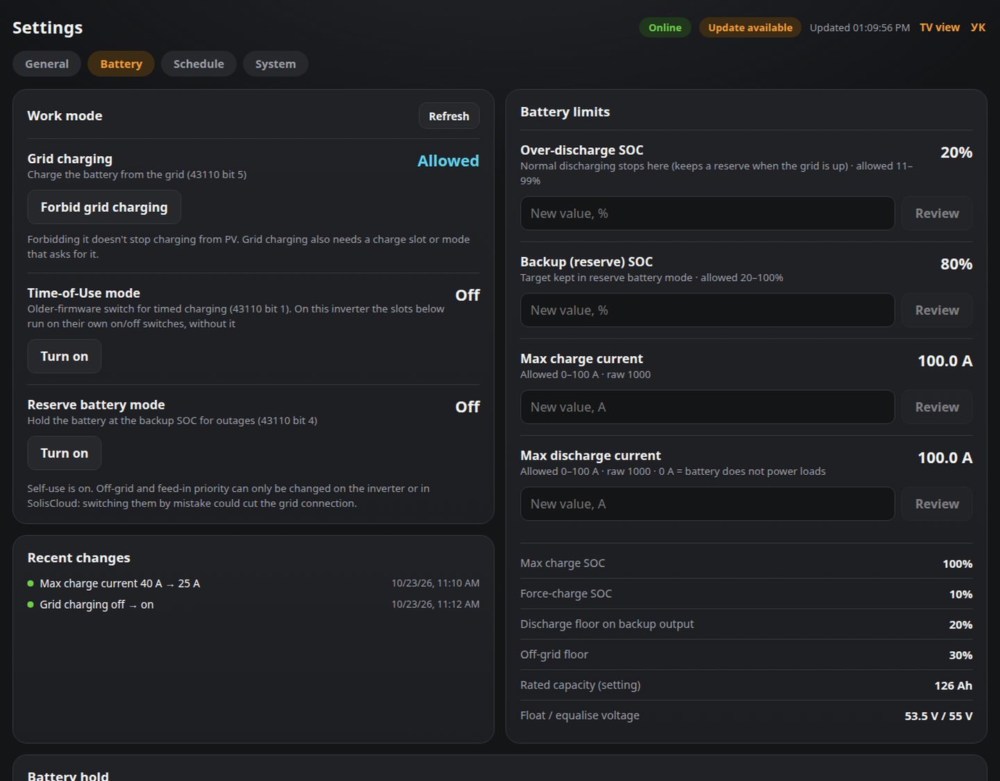

# Changing inverter settings

The Settings page has four tabs: **General** (electricity tariff, inverter clock, storage mode), **Battery** (work mode, limits, battery hold), **Schedule** (Time-of-Use slots) and **System** (software updates). The tab is kept in the address (`?view=settings&tab=battery`).

The Settings page reads the inverter's settings live, and can change these:

| Setting | Register | Notes |
|---|---|---|
| Grid charging allowed / forbidden | 43110 bit 5 | 1 = allowed (confirmed on this unit; the 2020 protocol PDF says the opposite) |
| Time-of-Use mode on/off | 43110 bit 1 | |
| Reserve battery mode on/off | 43110 bit 4 | keeps the battery at the backup SOC for outages |
| Over-discharge SOC | 43011 | normal discharging stops here; must be above force-charge SOC (43018) and below max charge SOC (43010) |
| Backup (reserve) SOC | 43024 | between over-discharge SOC and max charge SOC |
| Max charge SOC | 43010 | charging stops here; 70–100%, and at least the over-discharge SOC + 1, the backup SOC and both backup-output/off-grid floors (43137/43138) |
| Force-charge SOC | 43018 | below this the inverter charges from the grid to protect the battery; from 5% up to one below the over-discharge SOC and both backup-output/off-grid floors |
| Max charge / discharge current | 43117 / 43118 | 0 A discharge = the battery won't power loads |
| Time-of-Use slots, 6 charge + 6 discharge | 43707 (enable bits), 43708–43791 | start/end (may cross midnight), current, target SOC; slot currents are bounded by the same `MAX_*_CURRENT_A` |
| Inverter clock | 43000–43005 | "Sync to server time" writes the server's local time (`TZ`) |

The **Battery hold** card explains what the charge slots are doing: if an enabled charge slot covers most of the day and grid charging is allowed, the inverter keeps the battery at that slot's target, and the small top-ups every few hours (when the charge sags by 1–2%) are normal. It suggests how to stop them (night-only slot plus Reserve battery mode).

The page also shows read-only values: the backup-output and off-grid floors, rated capacity, charge voltages, and all storage-mode flags. Off-grid and feed-in priority are deliberately not switchable here: switching one by mistake could cut the grid connection.

Every write except 43110/43117/43118 uses a multi-register write (FC16), because newer Solis firmware silently ignores some single-register writes. Register addresses were checked against this inverter with read-only probes (this unit uses the six-slot Time-of-Use layout). They were not tested by writing, so make the first change of each kind while watching the inverter display or SolisCloud.

The poller stays the only Modbus client, and it follows the protocol's limits: at most 50 registers per request and at least 300 ms between requests. The web app forwards changes to the poller's internal API (`:8780`, Docker network only, never published), authenticated with `INFLUX_TOKEN`.

**Changes are refused until you finish these steps:**

1. **Turn on a password**: set `WEB_BASIC_AUTH=user:pass`. Without it the page is view-only. Add `WEB_AUTH_SETTINGS_ONLY=true` to keep the rest of the dashboard open and be asked for the password only when you open Settings.
2. **Verify the current scale.** Open Settings and compare *Max charge current* with the inverter display (Advanced settings → Battery → max charge current):
   - display 100 A, page 100 A (raw 1000) → `CURRENT_SCALE=0.1` (the default)
   - display 100 A, page 10 A (raw 100) → set `CURRENT_SCALE=1`
3. **Set hard limits** no higher than your battery/BMS rating, e.g. `MAX_CHARGE_CURRENT_A=100`, `MAX_DISCHARGE_CURRENT_A=100`. Values above these are refused, and `0` refuses changes to that setting.
4. Set `CONTROL_ENABLED=true` with `solis-monitor edit` (installer) or in `.env` followed by `docker compose up -d` in the install folder.
5. **Test with a harmless change** while watching the inverter display, e.g. limit charging to 30 A, then set it back.

How a change works:
- You enter a value. The page shows a summary such as "Max charge current: 100 A → 30 A", and you click Apply.
- One change runs at a time, with at least `MIN_WRITE_INTERVAL_S` (default 60 s) between changes.
- The poller writes the register, waits 3 s and reads it back. If the inverter didn't keep the value, the page says so. Some Solis firmwares only accept certain settings from the front panel or SolisCloud. In that case, don't keep retrying.
- Every change is logged to InfluxDB (measurement `solis_control`), shown under *Recent changes*, and logged in `docker compose logs poller`.

Notes:
- Forbidding grid charging doesn't stop the battery charging from PV.
- Whether grid charging actually happens also depends on the work mode and any Time-of-Use windows set on the inverter.
- The register numbers come from community documentation for Solis hybrids. Step 5 is how you confirm them on your unit.
